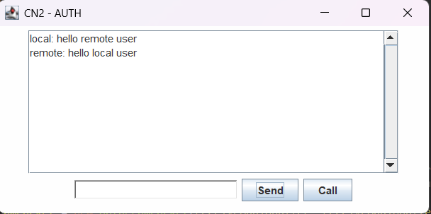
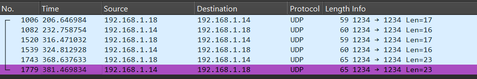

# P2P Chat and VoIP Application

A two-peer desktop application for text chat and voice calls, written in Java with plain UDP and TCP sockets.

Team project for the **Computer Networks II** course at ECE AUTH during the 2024–2025 academic year.

<p align="center">
  
</p>

## Branches

| Branch | What it contains |
|---|---|
| [`master`](../../tree/master) | The full version described in the report: chat, voice calls and AES-GCM encryption of text messages. |
| [`no-encryption`](../../tree/no-encryption) | The same chat and voice calls without encryption. Simpler, and more robust (see [Known limitations](#known-limitations)). |

## Features

- **Text chat over UDP:** each peer sends and receives datagrams on port 1234.
- **Voice calls over UDP:** audio is captured at 8 kHz, 8-bit, mono and streamed in 1024-byte datagrams on port 1243. Capture and playback run on separate threads, so chat and voice work at the same time.
- **Text chat over TCP:** an alternative client/server version of the chat on port 2345.
- **Encryption** (`master` only): UDP text messages are encrypted with AES-GCM. Both peers derive the same 128-bit key from a shared password (PBKDF2 with HMAC-SHA256), set with the *Set Pass* button.
- **Long messages** (`master` only): messages of up to 50,000 characters are split into 500-character chunks and reassembled by the receiver.

Only the Java standard library is used (`java.net`, `javax.sound`, `javax.crypto`, Swing).

## Traffic analysis

The exchanged packets were captured and analyzed in Wireshark: UDP and TCP text packets, the voice stream and individual voice packets. The capture below shows six chat datagrams between two machines on the same network.



The full analysis is in the report (in Greek): [`Documentation-Report.pdf`](Documentation-Report.pdf). It describes the code on `master`. Its LaTeX source is in [`report/`](report); to rebuild it, run `latexmk -pdf main.tex` inside that folder.

## Running it

Requirements: Java 8 or later and Maven.

1. Set the address of the other peer in `App.java` (`remoteAddress`; the default is `localhost`).
2. Build and start the application on both machines:

   ```bash
   mvn compile exec:java -Dexec.mainClass=com.cn2.communication.App
   ```

   You can also import the project into an IDE as a Maven project and run `App.java`.
3. On `master`: type the same password (at least 6 characters) on both sides and press *Set Pass*.
4. Press *Send* to send a message, or *Call* to start and stop a voice call.

The firewall must allow UDP traffic on ports 1234 and 1243. To use the TCP chat, enable the `TCPChatServer` and `TCPChatClient` lines in `App.java` on the two peers.

## Known limitations

The encryption on `master` is a proof of concept. After every message the sender switches to a new IV and sends it inside that message, so both peers must receive every message, in order. Because UDP does not guarantee delivery:

- If a single chat packet is lost, every later message fails to decrypt.
- If both peers press *Send* at the same moment, both messages fail, and so does the rest of the conversation.
- The encrypted version cannot be tested with one instance on a single machine (`localhost`), because the app decrypts its own message with the IV it has already moved past.
- The receiver reads at most 1024 bytes per packet. Greek characters take two bytes each, so a Greek message (or chunk) longer than 368 characters is cut off and cannot be decrypted. English text fits up to the 500-character chunk size.

Restarting both applications puts them back in sync. The chunks of a long message also share one IV, which AES-GCM is not meant to allow. The `no-encryption` branch has none of these issues.

## Project structure

```
src/main/java/com/cn2/communication/
  App.java             GUI and application logic
  UDPChat.java         text chat over UDP
  TCPChatClient.java   text chat over TCP (client side)
  TCPChatServer.java   text chat over TCP (server side)
  VoIP.java            voice streaming over UDP
  AudioRecord.java     microphone capture
  AudioPlayback.java   speaker playback
  AESci.java           AES-GCM encryption (master only)
report/
  main.tex             LaTeX source of the report
  images/              GUI screenshot and Wireshark captures used in the report
docs/                  images used in this README
```

## Team

- **Georgios Lavdakis:** UDP and TCP chat, voice streaming, Wireshark analysis
- **Georgios Vavouras:** encryption

The starting GUI template was provided by the course instructor, [Miltiadis Siavvas](https://github.com/siavvasm/CN2_AUTH_ChatAndVoIP).
